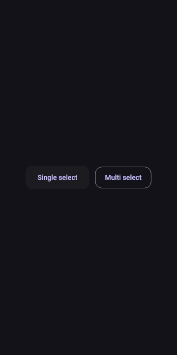
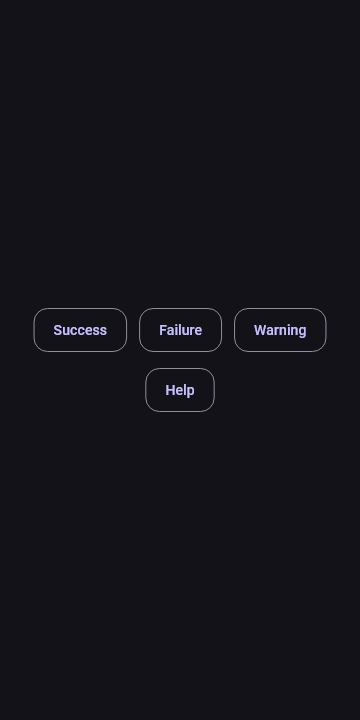
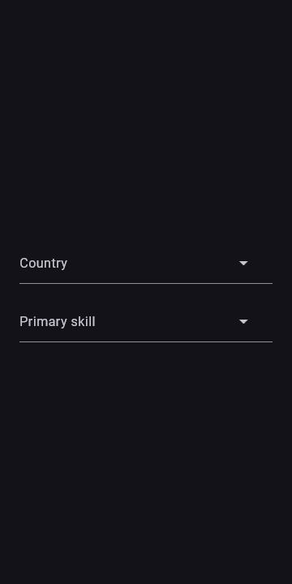
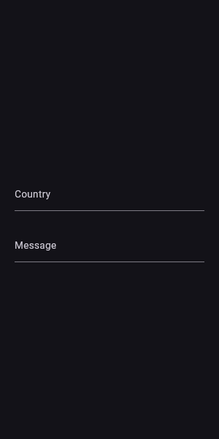
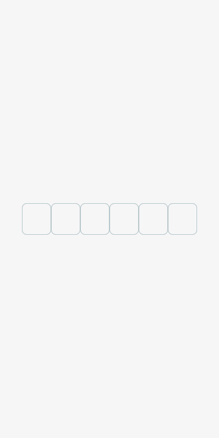
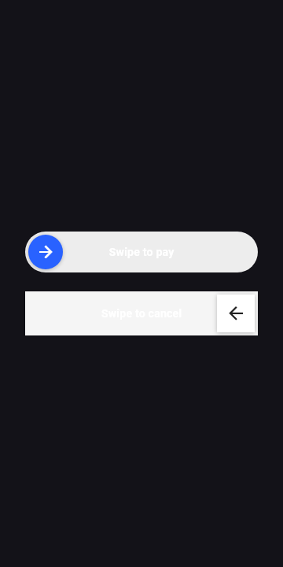
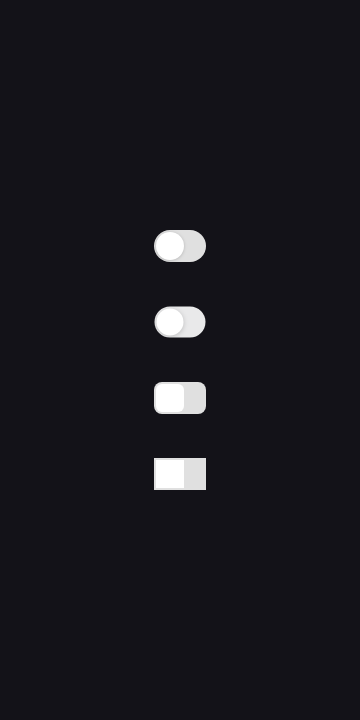

# awesome_custom_dialog

[](https://pub.dev/packages/awesome_custom_dialog)
[](https://pub.dev/packages/awesome_custom_dialog/score)
[](LICENSE)
[](#material-cupertino-or-adaptive)

Dialogs, toasts, snackbars, form fields and small UI controls for Flutter, all with one
easy-to-chain API. Show a ready-made success dialog in three lines, or style every pixel.

Every widget looks like **Material** by default, and can switch to **Cupertino** (iOS) or
**adaptive** with one line. There are no third-party dependencies, only Flutter's own
`material_ui` and `cupertino_ui`.

> **Upgrading from 1.x?** 2.0 needs Flutter 3.50 and changes a few defaults. See
> [Upgrading from 1.x](#upgrading-from-1x).

## Install

```yaml
dependencies:
  awesome_custom_dialog: ^2.0.0
```

```dart
import 'package:awesome_custom_dialog/awesome_custom_dialog.dart';
```

Needs **Flutter 3.50+** and **Dart 3.14+**. On an older Flutter, use `^1.6.0`.

## Quick start

**1. Show a dialog.** Build it, add content with `..`, then call `show()`:

```dart
ACDDialog().build(context)
  ..success(title: 'Saved!', message: 'Your changes are safe.')
  ..show();
```

**2. Show a toast.** A short message that closes on its own and never blocks taps:

```dart
ACDDialog.toast(context: context, message: 'Copied to clipboard').show();
```

**3. Get an answer back.** Use `actions` and `showForResult`:

```dart
final bool? delete = await (ACDDialog().build(context)
      ..text(text: 'Delete this photo?')
      ..actions(const [
        ACDAction(label: 'Cancel', role: ACDActionRole.cancel),
        ACDAction(label: 'Delete', role: ACDActionRole.destructive, value: true),
      ]))
    .showForResult<bool>();
```

**4. (Optional) Set a design and texts for the whole app.** Without this, everything is Material
and English.

```dart
ACDDesignScope(
  design: ACDDesign.adaptive, // iOS look on iPhone/Mac, Material elsewhere
  strings: const ACDStrings(ok: 'OK', cancel: 'Cancel'), // your translations
  child: MaterialApp(home: HomePage()),
);
```

## Features

| Group | Features |
|---|---|
| [Dialogs](#dialogs) | [Presets](#ready-made-presets) · [Content](#lists--custom-content) · [Position & style](#position-animation--style) · [Bottom sheet](#bottom-sheet) · [Loading](#loading-while-you-wait) · [Searchable list](#searchable-list) |
| [Messages](#messages) | [Toast](#toast) · [Promise & undo toasts](#promise--undo-toasts) · [Snackbar](#snackbar) · [One after another](#one-after-another) |
| [Form fields](#form-fields) | [Dropdown](#dropdown) · [Autocomplete](#autocomplete) · [PIN / OTP](#pin--otp) |
| [Controls](#controls) | [Slide to confirm](#slide-to-confirm) · [Switch](#switch) · [Rating bar](#rating-bar) · [Stepper](#stepper) · [Progress](#progress) |
| [Motion & decoration](#motion--decoration) | [Animate any widget](#animate-any-widget) · [Staggered lists](#staggered-lists--grids) · [Dashed & dotted](#dashed--dotted) |

---

## Dialogs

### Ready-made presets

Success, error, warning and info dialogs. Just add a title and a message.


```dart
ACDDialog().build(context)
  ..success(title: 'Awesome!', message: 'Payment received.')
  ..show();
// also: ..error(...)  ..warning(...)  ..info(...)
```

[example](example/lib/screens/presets_screen.dart)

### Lists & custom content

Mix text, buttons, a text field and lists in any order.


```dart
ACDDialog().build(context)
  ..text(text: 'Choose an option', fontSize: 18, fontWeight: FontWeight.bold)
  ..listOfACDListTile(
    items: const [
      ACDListTileItem(text: 'Edit', leading: Icon(Icons.edit)),
      ACDListTileItem(text: 'Share', leading: Icon(Icons.share)),
    ],
    onClickItemListener: (index) => print('Selected $index'),
  )
  ..show();
```

Also: `twoButton()`, `acdTextField(validator: …)`, `listOfACDRadioButton()`,
`listOfACDCheckbox()`, `acdProgress()`.
[example](example/lib/screens/dialog_content_screen.dart)

### Position, animation & style

Center, edges or corners; fade, scale, bounce, slide or rotate; any shape or gradient.


```dart
ACDDialog().build(context)
  ..gravity = ACDGravity.top
  ..animation = ACDAnimation.slideDown
  ..backgroundGradient = const LinearGradient(colors: [Colors.indigo, Colors.blue])
  ..text(text: 'Hello from the top!', color: Colors.white)
  ..show();
```

Positions mirror automatically in right-to-left languages.
[example](example/lib/screens/dialog_layout_screen.dart) ·
[all options](doc/advanced.md#dialog-options)

### Bottom sheet

A sheet that slides up from the bottom, with a grab handle. Drag it down to close it.

```dart
final target = await (ACDDialog.bottomSheet(context: context)
      ..text(text: 'Share to')
      ..actions(const [
        ACDAction(label: 'Mail', value: 'mail'),
        ACDAction(label: 'Messages', value: 'messages'),
      ]))
    .showForResult<String>();
```

[example](example/lib/screens/bottom_sheet_screen.dart) ·
[all options](doc/advanced.md#bottom-sheet)

### Loading while you wait

A progress dialog that stays up while your work runs, then returns its result.

```dart
final user = await ACDDialog.loading(
  context: context,
  future: api.signIn(email, password),
  message: 'Signing in…',
);
```

Fast work never flashes a dialog (`showAfter`), and `cancelable: true` adds a Cancel button.
[example](example/lib/screens/presets_screen.dart) ·
[all options](doc/advanced.md#loading-dialog)

### Searchable list

A list the user can filter by typing. Works with your own types and a server, too.



```dart
ACDDialog().build(context)
  ..height = 400
  ..searchableList<String>(
    items: countries,
    onChange: (country) => print('Picked $country'),
  )
  ..show();
```

Use `multiSearchableList<T>()` to pick several items.
[example](example/lib/screens/searchable_list_screen.dart) ·
[all options](doc/advanced.md#searchable-list)

---

## Messages

### Toast

A small message that closes on its own. It never blocks taps, and several toasts stack neatly.


```dart
ACDDialog.toast(
  context: context,
  message: 'Saved successfully',
  contentType: ACDContentType.success, // success, failure, warning or help
  showProgressBar: true,
  dragToDismiss: true,
).show();
```

[example](example/lib/screens/toast_screen.dart) ·
[all options](doc/advanced.md#toast)

### Promise & undo toasts

A promise toast turns from "Saving…" into a success or error message in place.

```dart
await ACDDialog.promiseToast(
  context: context,
  future: repo.save(note),
  loading: 'Saving…',
  success: (_) => 'Saved',
  error: (_) => 'Could not save',
);
```

An undo toast tells you whether the user tapped Undo:

```dart
final undone = await ACDDialog.undoToast(context: context, message: 'Message deleted');
if (!undone) await api.delete(message);
```

[example](example/lib/screens/toast_screen.dart) ·
[all options](doc/advanced.md#promise--undo-toasts)

### Snackbar

A colorful banner for success, failure, warning or help messages.



```dart
ACDDialog.snackbar(
  context: context,
  title: 'Success',
  message: 'Your changes have been saved.',
  contentType: ACDContentType.success,
).show();
```

[example](example/lib/screens/snackbar_screen.dart) ·
[all options](doc/advanced.md#snackbar)

### One after another

Show dialogs or toasts in order, without them overlapping.

```dart
for (final msg in ['Step 1', 'Step 2', 'Step 3']) {
  ACDDialogQueue.enqueue(
    ACDDialog.toast(context: context, message: msg, cancelPrevious: false),
  );
}
```

---

## Form fields

Every field works inside a normal `Form`, with `validator`, `onSaved` and `reset()`.
For switches, ratings and autocomplete, use `ACDSwitchFormField`, `ACDRatingFormField`
and `ACDAutocompleteFormField`.

### Dropdown

A searchable dropdown that sits in your form and shows the picked value.



```dart
ACDDropdownField<String>(
  items: countries,
  decoration: const InputDecoration(labelText: 'Country'),
  validator: (value) => value == null ? 'Required' : null,
)
```

Choose `mode:` dialog, bottom sheet, menu or iOS picker. `ACDMultiDropdownField` picks
several items and shows them as chips.
[example](example/lib/screens/dropdown_screen.dart) ·
[all options](doc/advanced.md#dropdown)

### Autocomplete

A text field that suggests matches as the user types, plus `@mentions` and `#hashtags`.



```dart
ACDAutocompleteField<String>(
  suggestions: countries,
  decoration: const InputDecoration(labelText: 'Country'),
  onSuggestionSelected: (country) => print('Picked $country'),
)
```

For triggers, use `ACDTriggerAutocompleteField(triggers: [ACDAutocompleteTrigger(trigger: '@', …)])`.
[example](example/lib/screens/autocomplete_screen.dart) ·
[all options](doc/advanced.md#autocomplete)

### PIN / OTP

A PIN or one-time-code field. SMS code autofill works out of the box.



```dart
final pin = ACDPinController();

ACDPinField(length: 6, controller: pin, onCompleted: verify);
ACDResendCountdown(onResend: () => auth.sendCode(phone)); // "Resend code (0:28)"

// after a wrong code:
pin..clear()..focus();
```

[example](example/lib/screens/pin_field_screen.dart) ·
[all options](doc/advanced.md#pin--otp)

---

## Controls

### Slide to confirm

The user must slide to confirm, so a stray tap can't trigger a payment or a delete.



```dart
final controller = ACDSlideActionController();

ACDSlideAction(
  controller: controller,
  label: 'Slide to pay',
  onConfirm: () async {
    controller.loading();
    final ok = await submitPayment();
    ok ? controller.success() : controller.reset();
  },
)
```

It confirms once; `controller.reset()` or `autoResetAfter` re-arms it.
[example](example/lib/screens/slide_action_screen.dart) ·
[all options](doc/advanced.md#slide-to-confirm)

### Switch

An on/off switch you can style any way you like.



```dart
ACDSwitch(value: isOn, onChanged: (value) => setState(() => isOn = value))
```

[example](example/lib/screens/switch_screen.dart) ·
[all options](doc/advanced.md#switch)

### Rating bar

Star ratings, with half stars and any icon.


```dart
ACDRatingBar(
  initialRating: 3,
  allowHalfRating: true,
  onRatingUpdate: (rating) => print('Rated $rating'),
)
```

[example](example/lib/screens/rating_bar_screen.dart) ·
[all options](doc/advanced.md#rating-bar)

### Stepper

Show progress through steps, as a bar or a vertical timeline.


```dart
ACDStepper(
  steps: const ['Cart', 'Address', 'Payment', 'Done'],
  activeStep: currentStep,
  onStepReached: (i) => setState(() => currentStep = i),
)
```

[example](example/lib/screens/stepper_screen.dart) ·
[all options](doc/advanced.md#stepper)

### Progress

Progress bars and circles, with an optional percentage label.


```dart
ACDLinearPercentIndicator(value: 0.4, showPercentageText: true);
ACDCircularPercentIndicator(radius: 60, value: 0.7, showPercentageText: true);
ACDLinearPercentIndicator(indeterminate: true); // unknown duration
```

[example](example/lib/screens/loaders_screen.dart) ·
[all options](doc/advanced.md#percent--loading-indicators)

---

## Motion & decoration

### Animate any widget

Wrap a widget to make it fade, slide, scale or pulse. `ACDAnimatedText` animates text letter
by letter.


```dart
ACDMotion(effect: ACDMotionEffect.fadeSlideIn(), child: const FlutterLogo())
```

[example](example/lib/screens/motion_screen.dart) ·
[all options](doc/advanced.md#motion)

### Staggered lists & grids

List rows or grid cells that slide in one after another.


```dart
ACDStaggeredList(
  itemCount: fruits.length,
  itemBuilder: (context, index) => ListTile(title: Text(fruits[index])),
)
```

[example](example/lib/screens/staggered_screen.dart) ·
[all options](doc/advanced.md#staggered-lists--grids)

### Dashed & dotted

Draw a dashed line, or put a dashed border around any widget.


```dart
ACDDashedBorder(
  shape: ACDDashedBorderShape.roundedRect,
  child: const Padding(padding: EdgeInsets.all(16), child: Text('Drop file here')),
)
```

[example](example/lib/screens/dashed_screen.dart) ·
[all options](doc/advanced.md#dashed--dotted)

---

## Material, Cupertino or adaptive

Every widget takes a `design:`. If you don't set one, it is **Material**.

| `ACDDesign` | Looks like |
|---|---|
| `material` (default) | Material 3 |
| `cupertino` | iOS: text fields, alert buttons, switches, pickers, blur |
| `adaptive` | iOS look on iPhone and Mac, Material everywhere else |

A widget's own `design:` wins over `ACDDesignScope`. Everything also works inside a plain
`CupertinoApp`.

**Accessibility is built in.**
- Screen readers can read every control.
- Keyboards work: Tab, Enter, arrow keys and Esc.
- Touch targets are at least 48 dp.
- "Reduce motion" turns animations off.

## Good to know

- **Right-to-left** layouts mirror automatically.
- **Tapping outside** closes a dialog; set `..barrierDismissible = false` to stop that.
- **Android back gesture** follows the predictive back animation; set `..canPop = false` to
  keep a dialog open.
- **Tests**: call `ACDToastManager.resetForTest()` and `ACDDialogQueue.reset()` in `tearDown`.

More in the [advanced guide](doc/advanced.md#design-accessibility--motion).

## Upgrading from 1.x

1. Update to Flutter 3.50+ and add `material_ui` to your `pubspec.yaml`.
2. Run `dart fix --apply --code=migrate_design_widgets`. It rewrites your imports.

No class, method or parameter was renamed or removed. A few things changed on purpose:
- **Defaults:**
  - bigger tap targets;
  - a darker warning color;
  - chips in the multi-select dropdown;
  - theme surfaces in Material dark mode.
- **Behaviour:**
  - the slide action confirms once;
  - `onBarrierTap` respects `canPop`;
  - a dialog with `autoDismissAfter: Duration.zero` stays open;
  - toasts and snackbars can be swiped away.

See [CHANGELOG.md](CHANGELOG.md) for the full list.

## Example app

[`example/`](example) has one screen per feature, with the code next to it:
`cd example && flutter run`.

## Learn more

- [Advanced guide](doc/advanced.md): every option for every widget, and the full API list
- [CHANGELOG.md](CHANGELOG.md)

## Contributing

Issues and pull requests are welcome on
[GitHub](https://github.com/devamitkumartiwari/awesome_custom_dialog/issues).

## License

MIT. See [LICENSE](LICENSE).
