# awesome_custom_dialog

[](https://pub.dev/packages/awesome_custom_dialog)
[](https://pub.dev/packages/awesome_custom_dialog/score)
[](LICENSE)
[](#material-cupertino-or-adaptive)

Dialogs, toasts, snackbars, form fields and small UI controls for Flutter, all with one
easy-to-chain API. Show a ready-made success dialog in three lines, or style every pixel.

Every widget looks like **Material** by default, and can switch to **Cupertino** (iOS) or
**adaptive** with one line. There are no third-party dependencies, only Flutter's own
`material_ui` and `cupertino_ui`.

> **Upgrading from 1.x?** 2.0 needs Flutter 3.50 and has a few breaking changes. See
> [Upgrading from 1.x](#upgrading-from-1x).

## Install

```yaml
dependencies:
  awesome_custom_dialog: ^2.0.0
```

```dart
import 'package:awesome_custom_dialog/awesome_custom_dialog.dart';
```

Needs **Flutter 3.50+** and **Dart 3.14+**. Still on an older Flutter? Use
`awesome_custom_dialog: ^1.6.0`.

## Quick start

**1. Show a dialog.** Build it, add content with `..`, then call `show()`:

```dart
ACDDialog().build(context)
  ..success(title: 'Saved!', message: 'Your changes are safe.')
  ..show();
```

**2. Show a toast.** A short message that closes on its own and never blocks taps:

```dart
ACDDialog.toast(context: context, message: 'Copied to clipboard')..show();
```

**3. (Optional) Pick a design for the whole app.** You can skip this. Without it, everything
is Material.

```dart
ACDDesignScope(
  design: ACDDesign.adaptive, // iOS look on iPhone/Mac, Material everywhere else
  child: MaterialApp(home: HomePage()),
);
```

### How a dialog is built

Every dialog follows the same three steps:

```dart
ACDDialog().build(context)        // 1. create it
  ..text(text: 'Choose a color')  // 2. add content, one `..` call per piece
  ..twoButton(text1: 'Cancel', text2: 'OK')
  ..show();                       // 3. show it
```

Need an answer back? Use `actions` and `showForResult`:

```dart
final bool? delete = await (ACDDialog().build(context)
      ..text(text: 'Delete this photo?')
      ..actions(const [
        ACDAction(label: 'Cancel', role: ACDActionRole.cancel),
        ACDAction(label: 'Delete', role: ACDActionRole.destructive, value: true),
      ]))
    .showForResult<bool>();
```

## Features

Each feature below has one sentence, one example, and a page in the
[example app](#example-app).

| Group | Features |
|---|---|
| [Dialogs](#dialogs) | [Ready-made presets](#ready-made-presets) · [Lists & custom content](#lists--custom-content) · [Position & animation](#position--animation) · [Text field with validation](#text-field-with-validation) · [Searchable list](#searchable-list) · [Dialog styling](#dialog-styling) |
| [Messages](#messages) | [Toast](#toast) · [Snackbar](#snackbar) · [One after another](#one-after-another) |
| [Form fields](#form-fields) | [Dropdown](#dropdown) · [Autocomplete](#autocomplete) · [@mentions & #hashtags](#mentions--hashtags) · [PIN / OTP](#pin--otp) |
| [Controls](#controls) | [Slide to confirm](#slide-to-confirm) · [Switch](#switch) · [Rating bar](#rating-bar) · [Stepper](#stepper) |
| [Progress](#progress) | [Percent & loading indicators](#percent--loading-indicators) |
| [Motion](#motion) | [Animate any widget](#animate-any-widget) · [Animated text](#animated-text) · [Staggered lists & grids](#staggered-lists--grids) |
| [Decorations](#decorations) | [Dashed & dotted lines and borders](#dashed--dotted-lines-and-borders) |
| [Design](#material-cupertino-or-adaptive) | Material, Cupertino or adaptive · accessibility |

---

## Dialogs

### Ready-made presets

Success, error, warning and info dialogs. Just add a title and a message.

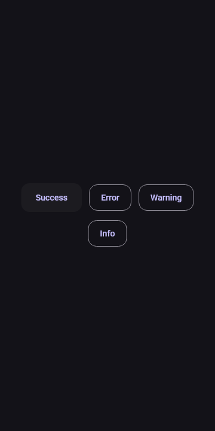

```dart
ACDDialog().build(context)
  ..success(title: 'Awesome!', message: 'Payment received.', onTap: () => print('OK'))
  ..show();
// also: ..error(...)  ..warning(...)  ..info(...)
```

[example](example/lib/screens/presets_screen.dart)

### Lists & custom content

Mix text, dividers, images, buttons and lists in any order.

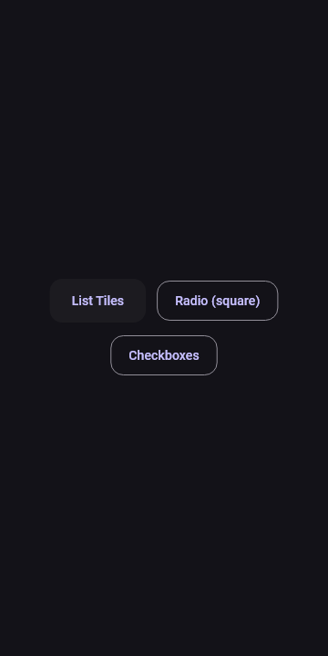

```dart
ACDDialog().build(context)
  ..width = 300
  ..text(text: 'Choose an option', fontSize: 18, fontWeight: FontWeight.bold)
  ..acdDivider()
  ..listOfACDListTile(
    items: [
      ACDListTileItem(text: 'Option 1', leading: Icon(Icons.star)),
      ACDListTileItem(text: 'Option 2', leading: Icon(Icons.settings)),
    ],
    onClickItemListener: (index) => print('Selected $index'),
  )
  ..show();
```

Radio and checkbox lists work the same way: `listOfACDRadioButton()` and `listOfACDCheckbox()`.
[example](example/lib/screens/buttons/buttons_hub_screen.dart)

### Position & animation

Show a dialog in the center, at an edge or in any corner, with fade, scale, bounce, rotate or
slide.

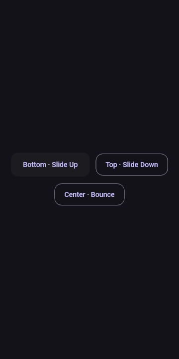

```dart
ACDDialog().build(context)
  ..gravity = ACDGravity.bottom
  ..animation = ACDAnimation.slideUp
  ..text(text: 'I slid up from the bottom!')
  ..show();
```

Positions mirror automatically in right-to-left languages.
[example](example/lib/screens/positioning_screen.dart)

### Text field with validation

Ask for input. The `validator` is optional.

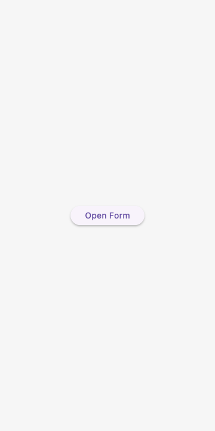

```dart
final fieldKey = GlobalKey<FormFieldState<String>>();
final dialog = ACDDialog().build(context)
  ..acdTextField(
    hint: 'Your name',
    fieldKey: fieldKey,
    validator: (v) => (v == null || v.trim().isEmpty) ? 'Name is required' : null,
  );
dialog
  ..oneButton(
    text: 'Submit',
    isClickAutoDismiss: false, // close only when the input is valid
    onTap: () {
      if (fieldKey.currentState?.validate() ?? false) dialog.dismiss();
    },
  )
  ..show();
```

[example](example/lib/screens/inputs_screen.dart)

### Searchable list

A list the user can filter by typing. Works with your own types, too.


```dart
ACDDialog().build(context)
  ..height = 400
  ..searchableList<String>(
    items: countries,
    searchHint: 'Search countries',
    onChange: (country) => print('Picked $country'),
  )
  ..show();
```

Use `multiSearchableList<T>()` to pick several items, or `onFind` to search a server.
[example](example/lib/screens/searchable_list_screen.dart) ·
[all options](doc/advanced.md#searchable-list)

### Dialog styling

Any shape, gradient, image background or shadow, and content that animates in piece by piece.

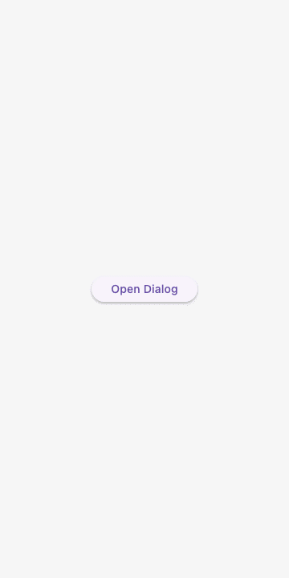

```dart
ACDDialog().build(context)
  ..shape = RoundedSuperellipseBorder(borderRadius: BorderRadius.circular(28))
  ..backgroundGradient = const LinearGradient(
    colors: [Color(0xFF6A11CB), Color(0xFF2575FC)],
  )
  ..contentStagger = const ACDStaggerOptions() // content appears one by one
  ..text(text: 'Styled dialog', color: Colors.white)
  ..oneButton(text: 'Nice')
  ..show();
```

[example](example/lib/screens/motion/dialog_styling_screen.dart) ·
[all options](doc/advanced.md#dialog-options)

---

## Messages

### Toast

A small message that closes on its own. It never blocks taps, and several toasts stack neatly.

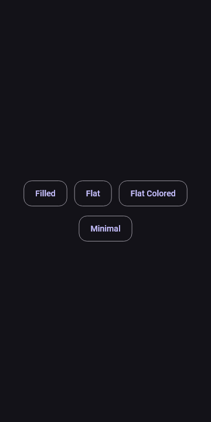

```dart
ACDDialog.toast(
  context: context,
  message: 'Saved successfully',
  contentType: ACDContentType.success, // success, failure, warning or help
  showProgressBar: true,
  dragToDismiss: true,
)..show();

ACDDialog.cancelToast(); // close the current toast
```

Want to know why it closed (timeout, tap, swipe)? `await toast.toastClosed`.
[example](example/lib/screens/toast/toast_screen.dart) ·
[all options](doc/advanced.md#toast)

### Snackbar

A colorful banner for success, failure, warning or help messages.


```dart
ACDDialog.snackbar(
  context: context,
  title: 'Success',
  message: 'Your changes have been saved.',
  contentType: ACDContentType.success,
)..show();
```

Already using `ScaffoldMessenger`? Put `ACDSnackbarContent` inside your own `SnackBar`.
[example](example/lib/screens/snackbar_screen.dart) ·
[all options](doc/advanced.md#snackbar)

### One after another

Show dialogs or toasts in order, without them overlapping.

```dart
for (final msg in ['Step 1', 'Step 2', 'Step 3']) {
  ACDDialogQueue.enqueue(
    ACDDialog.toast(context: context, message: msg, cancelPrevious: false),
  );
}
```

---

## Form fields

All form fields work inside a normal `Form`, with `validator`, `onSaved` and
`InputDecoration`.

### Dropdown

A searchable dropdown that sits in your form and shows the picked value.


```dart
ACDDropdownField<String>(
  items: countries,
  decoration: const InputDecoration(labelText: 'Country'),
  validator: (value) => value == null ? 'Required' : null,
  onChanged: (value) => print('Picked $value'),
)
```

- Open it as a dialog, bottom sheet, menu, or iOS picker with `mode:`.
- Pick several items with `ACDMultiDropdownField<T>`. They show as removable chips.
- Add `showClearButton: true` to let users clear the value.

[example](example/lib/screens/dropdown/dropdown_hub_screen.dart) ·
[all options](doc/advanced.md#dropdown)

### Autocomplete

A text field that suggests matches as the user types.


```dart
ACDAutocompleteField<String>(
  suggestions: countries,
  decoration: const InputDecoration(labelText: 'Country'),
  onSuggestionSelected: (country) => print('Picked $country'),
)
```

Use `onFind` to get suggestions from a server.
[example](example/lib/screens/autocomplete/typeahead_screen.dart)

### @mentions & #hashtags

Suggestions that start after a trigger character. Each trigger can search different data.

```dart
ACDTriggerAutocompleteField(
  decoration: const InputDecoration(labelText: 'Message'),
  triggers: [
    ACDAutocompleteTrigger(trigger: '@', optionsBuilder: findUsers),
    ACDAutocompleteTrigger(trigger: '#', optionsBuilder: findHashtags),
  ],
)
```

[example](example/lib/screens/autocomplete/trigger_screen.dart) ·
[all options](doc/advanced.md#autocomplete)

### PIN / OTP

A PIN or one-time-code field. SMS code autofill works out of the box.


```dart
ACDPinField(
  length: 6,
  onCompleted: (pin) => print('Entered $pin'),
  validator: (pin) => pin?.length == 6 ? null : 'Enter all 6 digits',
)
```

Add `obscureText: true` to hide the digits. On a wrong code the cells shake.
[example](example/lib/screens/pin_field/pin_field_screen.dart) ·
[all options](doc/advanced.md#pin--otp)

---

## Controls

### Slide to confirm

The user must slide to confirm, so a stray tap can't trigger a payment or a delete.


```dart
final controller = ACDSlideActionController();

ACDSlideAction(
  controller: controller,
  label: 'Slide to pay',
  onConfirm: () async {
    controller.loading();
    final ok = await submitPayment();
    ok ? controller.success() : controller.reset();
  },
)
```

Want a polished look with no styling? Use `ACDSlideAction.swipeButton(...)`.
[example](example/lib/screens/slide_action/slide_action_hub_screen.dart) ·
[all options](doc/advanced.md#slide-to-confirm)

### Switch

An on/off switch you can style any way you like.


```dart
ACDSwitch(
  value: isOn,
  onChanged: (value) => setState(() => isOn = value),
)
```

Ready-made looks: `ACDSwitch.material()` and `ACDSwitch.ios()`.
[example](example/lib/screens/switch/switch_hub_screen.dart) ·
[all options](doc/advanced.md#switch)

### Rating bar

Star ratings, with half stars and any icon.

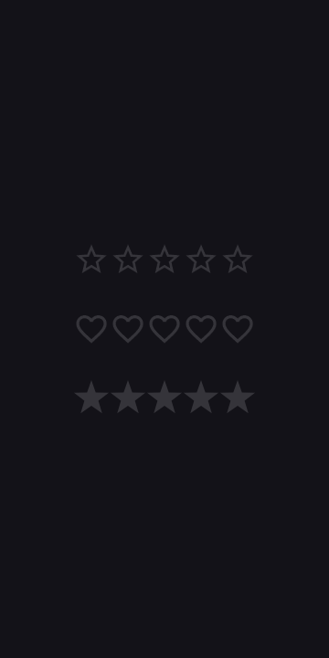

```dart
ACDRatingBar(
  initialRating: 3,
  allowHalfRating: true,
  onRatingUpdate: (rating) => print('Rated $rating'),
)
```

For a read-only rating, set `interactionMode: ACDRatingInteractionMode.none`.
[example](example/lib/screens/rating_bar/rating_bar_hub_screen.dart) ·
[all options](doc/advanced.md#rating-bar)

### Stepper

Show progress through steps, as a bar or a vertical timeline.

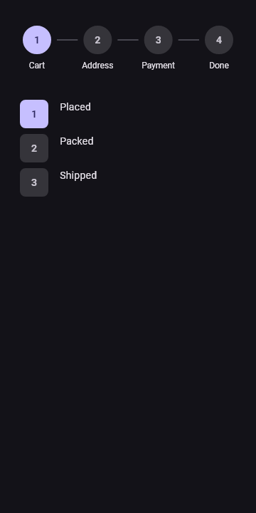

```dart
ACDStepper(
  steps: const ['Cart', 'Address', 'Payment', 'Done'],
  activeStep: currentStep,
  onStepReached: (i) => setState(() => currentStep = i),
)
```

Add `direction: Axis.vertical` for a timeline. For a long, scrollable history (like order
tracking), use `ACDStepperListView<T>`.
[example](example/lib/screens/stepper/stepper_hub_screen.dart) ·
[all options](doc/advanced.md#stepper)

---

## Progress

### Percent & loading indicators

Progress bars and circles, with an optional percentage label.

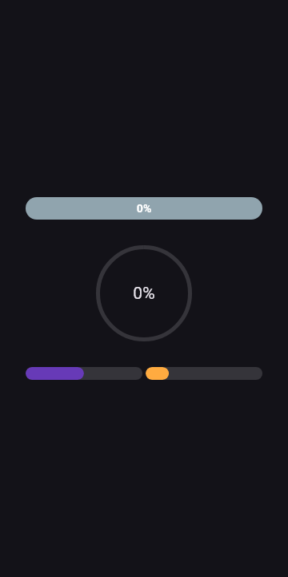

```dart
ACDLinearPercentIndicator(value: 0.4, showPercentageText: true);
ACDCircularPercentIndicator(radius: 60, value: 0.7, showPercentageText: true);
ACDLinearPercentIndicator(indeterminate: true); // when you don't know how long it takes
```

For several parts in one bar, use `ACDMultiSegmentLinearIndicator`.
[example](example/lib/screens/loaders/loaders_screen.dart) ·
[all options](doc/advanced.md#percent--loading-indicators)

---

## Motion

### Animate any widget

Wrap a widget to make it fade, slide, scale or pulse.

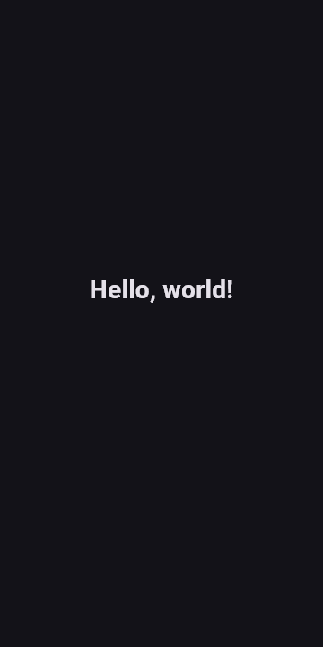

```dart
ACDMotion(
  effect: ACDMotionEffect.fadeSlideIn(),
  child: const FlutterLogo(),
)
```

[example](example/lib/screens/motion/motion_hub_screen.dart)

### Animated text

Text that appears letter by letter.

```dart
ACDAnimatedText(
  text: 'Hello, world!',
  effect: ACDMotionEffect.fadeSlideIn(),
  onComplete: () => print('done'),
)
```

[example](example/lib/screens/motion/animated_text_screen.dart) ·
[all options](doc/advanced.md#motion)

### Staggered lists & grids

List rows or grid cells that slide in one after another.

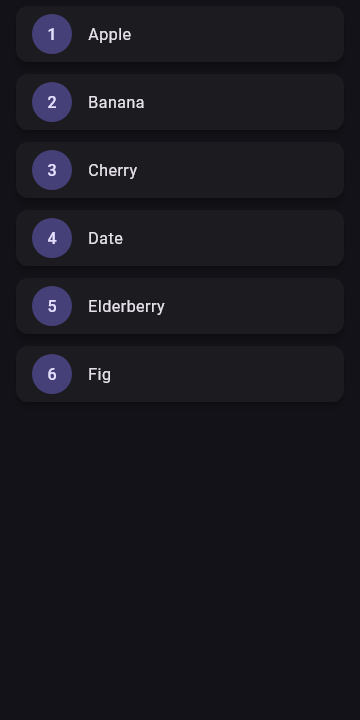

```dart
ACDStaggeredList(
  itemCount: fruits.length,
  itemBuilder: (context, index) => ListTile(title: Text(fruits[index])),
)
```

Grids work the same way with `ACDStaggeredGrid` and a `gridDelegate`.
[example](example/lib/screens/motion/staggered_list_screen.dart) ·
[all options](doc/advanced.md#staggered-lists--grids)

---

## Decorations

### Dashed & dotted lines and borders

Draw a dashed line, or put a dashed border around any widget.

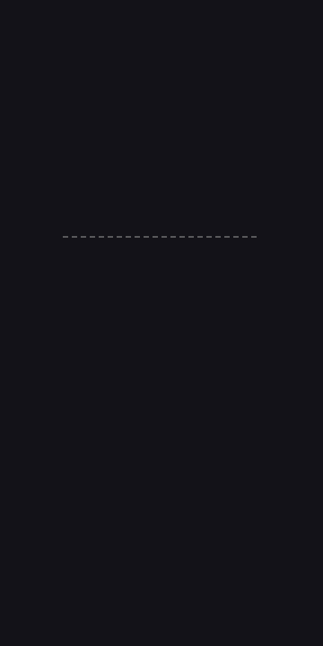

```dart
ACDDashedLine(length: 200, color: Colors.grey);

ACDDashedBorder(
  shape: ACDDashedBorderShape.roundedRect,
  child: const Padding(padding: EdgeInsets.all(16), child: Text('Drop file here')),
);
```

Need it as a `Decoration`? Use `Container(decoration: ACDDottedDecoration(...))`.
[example](example/lib/screens/dashed/dashed_hub_screen.dart) ·
[all options](doc/advanced.md#dashed--dotted)

---

## Material, Cupertino or adaptive

Every widget takes a `design:`. If you don't set one, it is **Material**.

| `ACDDesign` | Looks like |
|---|---|
| `material` (default) | Material 3 |
| `cupertino` | iOS: iOS text fields, alert buttons, switches, pickers, blur |
| `adaptive` | iOS look on iPhone and Mac, Material everywhere else |

```dart
ACDPinField(length: 6, design: ACDDesign.cupertino); // one widget
ACDDesignScope(design: ACDDesign.adaptive, child: MaterialApp(...)); // whole app
```

A widget's own `design:` always wins over the app-wide one. Everything also works inside a
plain `CupertinoApp`.

**Accessibility is built in.** Screen readers can read every control, keyboards work (Tab,
Enter, arrow keys, Esc), touch targets are at least 48 dp, and "reduce motion" turns
animations off. To translate the built-in text, pass
`ACDDesignScope(strings: ACDStrings(...))`.

## Customizing

Every widget has good defaults, and you can change all of it: colors, gradients, fonts,
corner radius, shapes, shadows, padding, icons. For example, a styled button:

```dart
ACDDialog().build(context)
  ..oneButton(
    text: 'Done',
    color: Colors.white,
    backgroundColor: Colors.teal,
    borderRadius: BorderRadius.circular(12),
    icon: Icons.check_circle_outline,
  )
  ..show();
```

The full list per widget is in [Customizing everything](doc/advanced.md#customizing-everything).
[example](example/lib/screens/customization/customization_hub_screen.dart)

## Example app

[`example/`](example) has a page for every feature, with the code next to it.

```sh
cd example
flutter run
```

## Good to know

- **Right-to-left** languages are handled for you: positions, slides and drags mirror
  automatically.
- **Notches and system bars** are avoided by top and bottom dialogs.
- **Tapping outside** closes a dialog. Set `..barrierDismissible = false` to stop that.
- **Android back gesture**: dialogs follow the predictive back animation. Set
  `..canPop = false` to keep one open.
- **Toasts above everything**: wrap your app once with `ACDToastLayer` (optional) so toasts
  get their own layer:
  ```dart
  MaterialApp(builder: (context, child) => ACDToastLayer(child: child!), home: ...);
  ```

## Upgrading from 1.x

2.0 moves to Flutter's standalone `material_ui` package.

1. Update to Flutter 3.50+ and add `material_ui` to your `pubspec.yaml`.
2. Run `dart fix --apply --code=migrate_design_widgets`. It rewrites your imports.

No class, method or parameter was renamed or removed. Three default looks changed on purpose
(bigger tap targets, a darker warning color, chips in the multi-select dropdown). See
[CHANGELOG.md](CHANGELOG.md) for details.

## Learn more

- [Advanced guide](doc/advanced.md): every option for every widget, and the full API list
- [CHANGELOG.md](CHANGELOG.md)

## Contributing

Issues and pull requests are welcome on
[GitHub](https://github.com/devamitkumartiwari/awesome_custom_dialog/issues).

## License

MIT. See [LICENSE](LICENSE).
